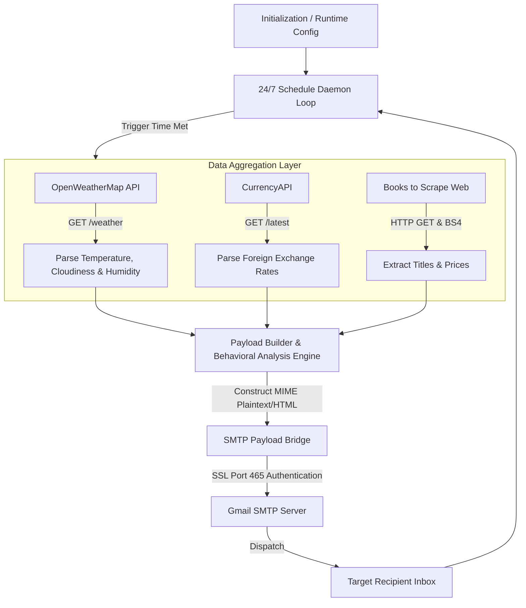

# 🤖 Auto-Gmail Information Engine

[](https://www.python.org/)
[](https://openweathermap.org/)
[](https://www.crummy.com/software/BeautifulSoup/)
[](https://opensource.org/licenses/MIT)

The **Auto-Gmail Information Engine** is an automated Python intelligence daemon designed to aggregate multi-source daily telemetry including live weather analytics, real-time currency exchange rates, and trending bookstore literature. It compiles these disparate data streams into a unified digest and securely routes them to designated recipients via automated SMTP SSL dispatch on a configurable 24/7 schedule.

---

## 2. Core Architectural Diagram

The system operates on an automated loop that integrates live external REST APIs and HTML web scraping endpoints before constructing and delivering an encrypted email payload.



---

## 3. Complete Source Codebase

<details><summary><b>📂 Expand Complete Source Code (main.py)</b></summary>

```python
import smtplib
from email.message import EmailMessage
import requests
from bs4 import BeautifulSoup
import schedule
import time

# ==========================================
# CONFIGURATION & CONSTANTS
# ==========================================
SENDER_EMAIL = "your_email@gmail.com"
SENDER_APP_PASSWORD = "your_app_password"  # App-specific password for Gmail SSL
RECEIVER_EMAIL = "receiver_email@gmail.com"

CURRENCY_API_KEY = "your_currency_api_key"
WEATHER_API_KEY = "your_weather_api_key"
CITY = "Dhaka"

# ==========================================
# DATA AGGREGATION FUNCTIONS
# ==========================================

def get_weather():
    """
    Fetch weather information for a specified city using OpenWeatherMap API.
    Calculates behavioral suggestions based on cloudiness and humidity.
    """
    url = f"http://api.openweathermap.org/data/2.5/weather?q={CITY}&appid={WEATHER_API_KEY}&units=metric"
    try:
        response = requests.get(url)
        data = response.json()
        if response.status_code == 200:
            temp = data['main']['temp']
            humidity = data['main']['humidity']
            description = data['weather'][0]['description']
            clouds = data['clouds']['all']

            # Behavioral / Contextual Logic
            advice = []
            if clouds > 70 or "rain" in description.lower():
                advice.append("High probability of overcast/rain. Consider bringing an umbrella.")
            if humidity > 80:
                advice.append("High humidity levels expected today.")
            if temp > 30:
                advice.append("Warm weather alert: Stay hydrated.")
            elif temp < 15:
                advice.append("Cooler weather: Dress warmly.")
            
            if not advice:
                advice.append("Weather conditions appear moderate and pleasant.")

            suggestion_str = " ".join(advice)

            return (
                f"City: {CITY}\n"
                f"Temperature: {temp}°C\n"
                f"Humidity: {humidity}%\n"
                f"Conditions: {description.capitalize()}\n"
                f"Cloud Cover: {clouds}%\n"
                f"Recommendation: {suggestion_str}"
            )
        else:
            return f"Failed to retrieve weather data. API Response: {data.get('message', 'Unknown Error')}"
    except Exception as e:
        return f"Error fetching weather data: {str(e)}"


def get_currency_rates():
    """
    Fetch exchange rates for target currencies using CurrencyAPI.
    """
    url = f"https://api.currencyapi.com/v3/latest?apikey={CURRENCY_API_KEY}&currencies=USD%2CEUR%2CGBP%2CBDT"
    try:
        response = requests.get(url)
        data = response.json()
        if response.status_code == 200 and 'data' in data:
            rates = data['data']
            usd_bdt = rates.get('BDT', {}).get('value', 'N/A')
            usd_eur = rates.get('EUR', {}).get('value', 'N/A')
            usd_gbp = rates.get('GBP', {}).get('value', 'N/A')

            return (
                f"USD to BDT: {usd_bdt}\n"
                f"USD to EUR: {usd_eur}\n"
                f"USD to GBP: {usd_gbp}"
            )
        else:
            return "Failed to fetch currency rates. Please verify API Key."
    except Exception as e:
        return f"Error fetching currency rates: {str(e)}"


def get_trending_books():
    """
    Scrape book titles and prices from Books to Scrape using BeautifulSoup4.
    """
    url = "http://books.toscrape.com/"
    try:
        response = requests.get(url)
        if response.status_code == 200:
            soup = BeautifulSoup(response.text, 'html.parser')
            books = soup.find_all('article', class_='product_pod', limit=5)
            book_list = []
            for idx, book in enumerate(books, start=1):
                title = book.h3.a['title']
                price = book.find('p', class_='price_color').text
                book_list.append(f"{idx}. {title} - {price}")
            return "\n".join(book_list)
        else:
            return "Failed to scrape book recommendations."
    except Exception as e:
        return f"Error scraping book data: {str(e)}"


# ==========================================
# MAIL ENGINE & ORCHESTRATION
# ==========================================

def send_email():
    """
    Aggregates data feeds, formats MIME message payload, and transmits via SSL Port 465.
    """
    print("Gathering real-time intelligence data...")
    weather_info = get_weather()
    currency_info = get_currency_rates()
    book_info = get_trending_books()

    body = (
        "Good morning!\n\n"
        "Here is your automated daily information digest:\n\n"
        "==========================================\n"
        "1. WEATHER REPORT & ANALYSIS\n"
        "==========================================\n"
        f"{weather_info}\n\n"
        "==========================================\n"
        "2. CURRENCY EXCHANGE RATES (Base USD)\n"
        "==========================================\n"
        f"{currency_info}\n\n"
        "==========================================\n"
        "3. FEATURED BOOK RECOMMENDATIONS\n"
        "==========================================\n"
        f"{book_info}\n\n"
        "------------------------------------------\n"
        "Automated with Python | Final-Project-Auto-Gmail"
    )

    msg = EmailMessage()
    msg['Subject'] = f"Daily Automated Intelligence Briefing - {CITY}"
    msg['From'] = SENDER_EMAIL
    msg['To'] = RECEIVER_EMAIL
    msg.set_content(body)

    try:
        # Establish secure SSL connection over Port 465
        with smtplib.SMTP_SSL("smtp.gmail.com", 465) as server:
            server.login(SENDER_EMAIL, SENDER_APP_PASSWORD)
            server.send_message(msg)
        print("Daily briefing email dispatched successfully!")
    except Exception as e:
        print(f"Failed to dispatch email: {str(e)}")


def main():
    """
    Initializes the continuous thread lifecycle daemon.
    """
    print("Auto-Gmail Information Engine initialized.")
    
    # Schedule the dispatch trigger daily at 08:00 AM
    schedule.every().day.at("08:00").do(send_email)
    
    print("Daemon active. Listening for trigger schedules... (Press Ctrl+C to exit)")
    
    while True:
        schedule.run_pending()
        time.sleep(60)

if __name__ == "__main__":
    main()
```

</details>

---

## 4. Technical Stack & Mechanism Breakdown

### Data Source Technology Matrix

| Feature Module | Extraction Mechanism | Provider / Target Endpoint | Returned Data Structure |
| :--- | :--- | :--- | :--- |
| **Weather Analysis** | REST API (`requests`) | OpenWeatherMap API | JSON object containing temperature, humidity, cloud coverage, and weather descriptions. |
| **Currency Rates** | REST API (`requests`) | CurrencyAPI | Nested JSON payload mapped by ISO 4217 currency key codes. |
| **Book Discovery** | Web Scraping (`BeautifulSoup4`) | Books to Scrape (`books.toscrape.com`) | HTML DOM element parsing (`<article class="product_pod">`). |

---

### Deep Mechanics Breakdown

#### Dynamic Weather Logic
The weather engine evaluates raw metrics returned from OpenWeatherMap to dynamically generate contextual behavioral suggestions:
* **Overcast & Precipitation:** Analyzes `clouds['all']` percentages ($> 70\%$) and inspects string conditions for precipitation keywords to flag rain warnings.
* **Atmospheric Comfort:** Evaluates relative humidity ($> 80\%$) and temperature thresholds ($> 30^\circ\text{C}$ for heat, $< 15^\circ\text{C}$ for cold) to append tailored lifestyle suggestions.

#### The SMTP Payload Bridge
Email delivery utilizes Python's built-in `email.message.EmailMessage` and `smtplib` libraries:
1. **Message Assembly:** Plaintext content is mapped into an standardized `EmailMessage` MIME structure containing dynamic envelope headers (`Subject`, `From`, `To`).
2. **Encrypted Transport:** Connects directly over **SMTP_SSL Port 465** directly establishing an encrypted TLS/SSL session from socket initialization, mitigating MITM vulnerabilities during credential transfer and transmission.

#### Continuous Thread Lifecycle
The application acts as a lightweight 24/7 background daemon:
* The core process registers `send_email` using `schedule.every().day.at("08:00")`.
* An infinite execution block (`while True`) continuously checks for pending execution tasks via `schedule.run_pending()`.
* A explicit `time.sleep(60)` delay prevents high CPU core utilization while keeping CPU usage close to $0\%$.

---

## 5. Installation & Runtime Orchestration

### Prerequisites & Dependencies

Provision your runtime environment using `pip`:

```bash
pip install requests beautifulsoup4 schedule
```

---

### Runtime Environment Variables

Configure the following variables directly inside `main.py` before launching:

| Variable Name | Description | Security / Source Context |
| :--- | :--- | :--- |
| `SENDER_EMAIL` | Gmail address used to dispatch emails | Standard Gmail address. |
| `SENDER_APP_PASSWORD` | 16-character Gmail App Password | Requires Google 2FA enabled. Generated via Google Account Security settings. |
| `RECEIVER_EMAIL` | Target destination email address | Any valid email account capable of accepting incoming SMTP mail. |
| `CURRENCY_API_KEY` | API Key for foreign exchange rates | Sourced from [CurrencyAPI](https://currencyapi.com/). |
| `WEATHER_API_KEY` | API Key for meteorological updates | Sourced from [OpenWeatherMap](https://openweathermap.org/api). |

---

### Terminal Execution Instructions

Execute the script directly to launch the background daemon:

```bash
python main.py
```

To run the process in the background on Linux/macOS environments:

```bash
nohup python main.py > engine.log 2>&1 &
```

<p align="center">
  <strong>Authorized by Rayaan Tasnim</strong><br>
  <em>All rights reserved.</em>
</p>

